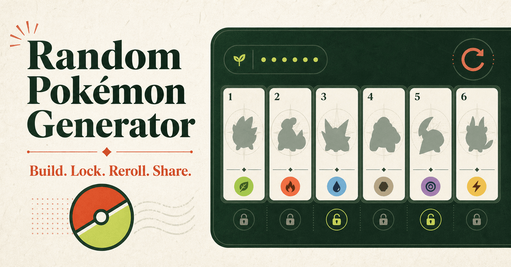

# Random Pokémon Generator

An open-source, mobile-friendly Pokémon picker and team generator covering all 1,025 main species from Generations 1–9.

**Live site:** [randompokemon.xyz](https://randompokemon.xyz)



## Overview

Random Pokémon Generator creates reproducible single picks or teams of up to six Pokémon from a bundled local dataset. It is designed for casual playthroughs, Nuzlocke encounters, monotype runs, drafts, creative prompts, and anyone who wants a fast Pokémon picker without waiting on an API for every roll.

The default experience generates a Smart Team of six. Every result can be refined, locked, rerolled, analyzed, saved locally, and shared through a URL that preserves the complete team state.

## Features

### Generation and filtering

- Generate 1–6 Pokémon with deterministic, human-readable seeds.
- Choose between **Pure Random** and **Smart Team** generation.
- Filter by generation, region, type, evolution stage, base stat total, or fully evolved status.
- Match either any selected type or both types of a dual-type Pokémon.
- Control Legendary, Mythical, Paradox, Ultra Beast, regional, Mega, and Gigantamax eligibility.
- Allow or prevent duplicate team members.
- Use focused presets for starters, Legendary Pokémon, Shiny Pokémon, Nuzlockes, monotype teams, and individual regions.

### Team controls

- Lock selected members and reroll only unlocked slots.
- Reroll or remove one Pokémon without changing the rest of the team.
- Add a random Pokémon to an open slot.
- Toggle normal and Shiny artwork independently for each card.
- View abilities, nature, base stats, type matchups, generation, region, evolution, and category details.
- Analyze type distribution, shared weaknesses, resistances, immunities, and average BST.

### Sharing and persistence

- Recreate the same roll from a seed.
- Share a URL containing the seed, filters, Pokémon, abilities, natures, Shiny state, and locked state.
- Copy a formatted text version of a generated pick or team.
- Keep up to 10 recent generations and 20 favorite teams in browser `localStorage`.
- Use responsive light and dark themes on desktop, tablet, and mobile.

### Additional tools and content

- Searchable Pokédex with 1,025 statically generated detail pages.
- Pokémon comparison, favorite picker, type wheel, and team planner.
- Type, Shiny, Legendary, starter, and regional collections.
- Split XML sitemaps, canonical URLs, structured data, Open Graph metadata, `robots.txt`, and `llms.txt`.

## How Smart Team Works

Pure Random gives every eligible Pokémon an equal chance of selection. Smart Team remains random, but samples multiple valid teams and favors results with:

- more type variety;
- fewer repeated primary types;
- fewer weaknesses shared by four or more members; and
- fewer unevolved Pokémon on the same team.

All active filters are applied before scoring. Smart Team is intended to produce more varied casual teams; it is not a competitive battle simulator or moveset optimizer.

## Tech Stack

- [Next.js](https://nextjs.org/) App Router
- [React](https://react.dev/) and TypeScript
- [Tailwind CSS](https://tailwindcss.com/)
- [Vitest](https://vitest.dev/)
- [`@pkmn/dex`](https://github.com/pkmn/ps) and PokéAPI-derived metadata
- Cloudflare Workers deployment with vinext, Vite, and prerendered static assets
- The original Next.js / Vercel build remains available

## Getting Started

### Requirements

- Node.js 24.22.0 or later within Node 24 (`nvm use` reads `.nvmrc`)
- npm

### Installation

```bash
git clone <your-repository-url>
cd randompokemon
npm ci
npm run dev
```

Open [http://localhost:3000](http://localhost:3000) in your browser.

### Analytics

GA4 uses the fixed measurement ID `G-7X3S8XR68Z` in `src/components/analytics/GoogleAnalytics.tsx`. No application environment variables are required. Page views are tracked on route changes without including query-string state.

## Available Scripts

| Command | Description |
| --- | --- |
| `npm run dev` | Start the Next.js development server. |
| `npm run build` | Create an optimized production build. |
| `npm run start` | Run the production build locally. |
| `npm run dev:cf` | Develop with vinext in the Workers runtime on port 3001. |
| `npm run build:cf` | Build the Worker and prerender eligible routes into Cloudflare static assets. |
| `npm run preview:cf` | Preview the Cloudflare production build locally on port 4173. |
| `npm run test:cf` | Smoke-test a running Cloudflare preview (default: `http://localhost:4173`). |
| `npm run deploy:check` | Validate an existing Cloudflare build with a deployment dry run; uploads nothing. |
| `npm run deploy` | Build and deploy to Cloudflare Workers using the official vinext adapter and cf CLI. |
| `npm run typecheck` | Regenerate Next.js route types, then check TypeScript (safe after switching build tools). |
| `npm run lint` | Run ESLint across the project. |
| `npm test` | Run the complete Vitest suite once. |
| `npm run test:watch` | Run Vitest in watch mode. |
| `npm run data:update` | Rebuild the dataset with fresh PokéAPI metadata. |
| `npm run data:update:offline` | Rebuild battle data while reusing validated local PokéAPI metadata. |

## Pokémon Data

The generated dataset currently contains 1,206 normalized records: 1,025 default species and 181 supported forms. It is written to both:

- `src/data/pokemon.json` for server-side imports and static generation;
- `public/data/pokemon.json` for client-side generator loading.

To refresh it from PokéAPI and the installed `@pkmn/dex` version:

```bash
npm run data:update
```

The update script validates metadata coverage and form quality before replacing either output. Use the offline command when network access is unavailable; it reuses height and category metadata from the existing public dataset.

Sprite URLs are sourced from the PokeAPI sprite repository for default forms and Pokémon Showdown for supported alternate forms.

## Project Structure

```text
app/                         Next.js routes, metadata, and sitemap handlers
src/components/
  generator/                 Generator controls and state
  pokemon/                   Cards, details, directory, and type badges
  team/                      Team analysis UI
  tools/                     Compare, picker, wheel, and planner tools
src/data/                    Pokémon data and curated reference data
src/lib/                     Filtering, randomization, URL state, SEO, and storage
src/types/                   Shared TypeScript models
public/data/pokemon.json     Browser-ready Pokémon dataset
scripts/fetch-pokemon-data.ts
tests/                       Vitest unit and integration-style tests
```

The `@/` import alias maps to `src/`.

## Validation

Run the standard checks before submitting a change:

```bash
npm run lint
npm test
npm run build
npm run typecheck
npm run build:cf
npm run deploy:check
```

The test suite covers dataset quality, page defaults, filters, deterministic random generation, URL-state round trips, type calculations, team analysis, static generation, canonical rules, and sitemap output.

## Deployment

### Cloudflare Workers

This is a Workers application, not a Pages static export. `vite.config.ts` runs the App Router through vinext and the Cloudflare Vite plugin. Eligible pages (including the Pokédex) are prerendered; the Worker handles dynamic Team Planner parameters, redirects, 404s, and the `proxy.ts` query-string indexation policy. No D1, KV, R2, or other storage resources are required.

The project pins its adapter and CLI versions, including the cf CLI and Cloudflare Vite plugin beta releases. Upgrade these together and repeat the checks below.

```bash
nvm use
npm ci
npm run build:cf
npm run deploy:check
npm run preview:cf
```

In a second terminal, run `npm run test:cf` to check the preview. To use another origin, run `npm run test:cf -- http://localhost:4174`.

When ready to publish:

```bash
npx cf auth login
npm run deploy
```

The Worker name is `random-pokemon-generator` in `cloudflare.config.ts`. For CI, provide `CLOUDFLARE_API_TOKEN` and `CLOUDFLARE_ACCOUNT_ID` through the build service's secret settings. Never commit credentials.

For Cloudflare Workers Builds connected to Git, use:

| Setting | Value |
| --- | --- |
| Root directory | Repository root |
| Worker name | `random-pokemon-generator` |
| Build command | `npm run build:cf` |
| Deploy command | `npx cf deploy --prebuilt --mode production` |
| Build variable `NODE_VERSION` | `24.22.0` |

The deploy command consumes `.cloudflare/output/v0/` from that build; it is not a Pages output-directory setting. GA4 is included automatically with the fixed measurement ID above; no analytics environment variable is needed.

After verifying the Worker URL, attach `randompokemon.xyz` in the Worker's **Settings → Domains & Routes**. Canonicals, sitemaps, and social metadata intentionally use this production domain. Source configuration does not attach a domain automatically.

Keep requests routed through the configured Worker so redirects and `X-Robots-Tag: noindex, follow` remain effective for parameterized pages. Do not apply a blanket HTML cache rule that ignores query strings. Static cache files under `/_vinext/static-cache/` are private to the adapter and must not bypass the Worker. Logs and sampled traces are enabled, with query strings redacted from platform logs.

### Existing Node.js / Vercel workflow

The repository retains `vercel.json`. For Vercel or another Node.js host, install dependencies, run `npm run build`, and serve the result with `npm run start` where needed. The `*:cf` commands are specific to Workers.

## Data and Browser Behavior

- Generation runs against the bundled dataset after it is loaded by the browser.
- Recent generations and favorites stay in that browser's `localStorage`; there is no account sync.
- Share URLs encode team state, so review the URL before sharing if you consider a custom seed private.
- Clearing site storage removes saved recent generations and favorites.

## Disclaimer

RandomPokemon.xyz is an independent, unofficial fan-made project. Pokémon and Pokémon character names are trademarks of Nintendo, Game Freak, Creatures Inc., and The Pokémon Company. This project is not affiliated with or endorsed by those companies.
